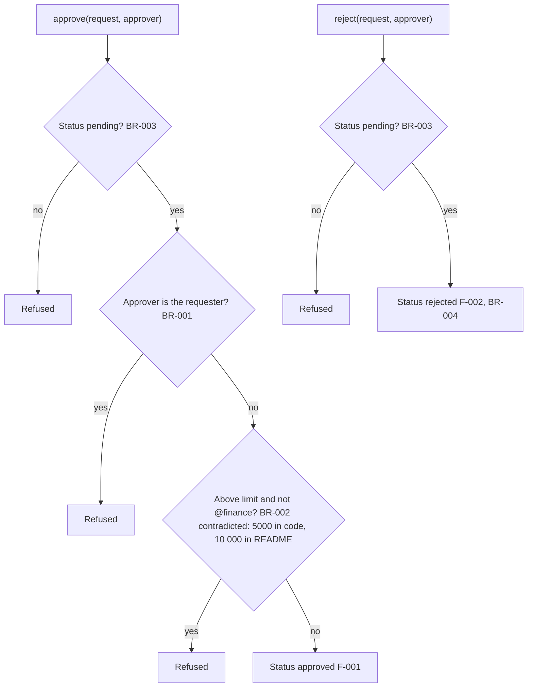

# Feature Catalog and User Journeys

| ID | Feature | Confidence | Criticality |
| --- | --- | --- | --- |
| F-001 | Approve a pending request | confirmed | high — authorises spending |
| F-002 | Reject a pending request | confirmed | medium |
| F-003 | Notify the requester of a rejection | gap (TODO only) | low |

## Critical journeys

Request raised → approver approves (F-001, subject to BR-001, BR-002, BR-003) or rejects (F-002, subject to BR-003).

The checks each action applies, in the order the code applies them (F-001, F-002, BR-001, BR-003, BR-004 confirmed; BR-002 contradicted). Rejecting skips the requester and limit checks (BR-004). No notification is drawn: F-003 is a gap.

## Observed acceptance criteria

- F-001: given a pending request of 100 raised by another person, when an approver approves it, then its status is `approved`.
- BR-001: given a request raised by ana@ops, when ana@ops approves it, then it is refused.
- BR-003: given a rejected request, when anyone approves it, then it is refused.
- No test covers BR-002, F-002 or BR-004 (ARCH-002).

## Variants, flags and parameters

| Parameter or flag | Where set | Default | Configurable or hard-coded | Affects | Evidence claim |
| --- | --- | --- | --- | --- | --- |
| `APPROVAL_LIMIT` | `src/requests.py` line 3 | 5000 | hard-coded | Who may approve (BR-002) | BR-002 |

No feature flags or variants observed.

## Non-observable behavior

No scheduled jobs, workers, event consumers or webhooks observed (ARCH-001). Whether the requester learns of a rejection (F-003).
